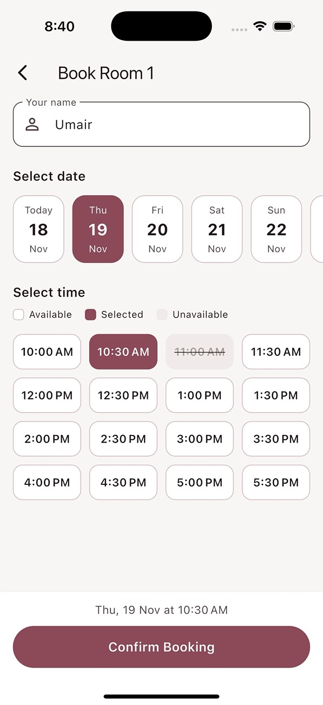
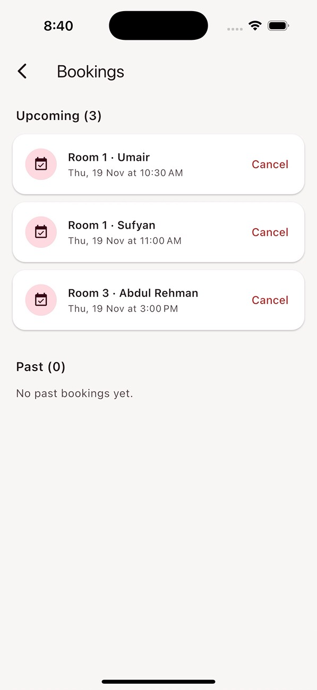
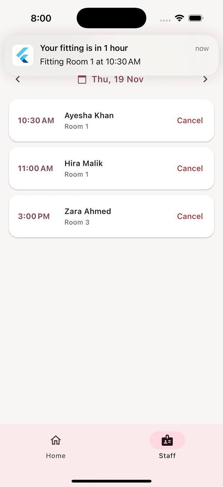
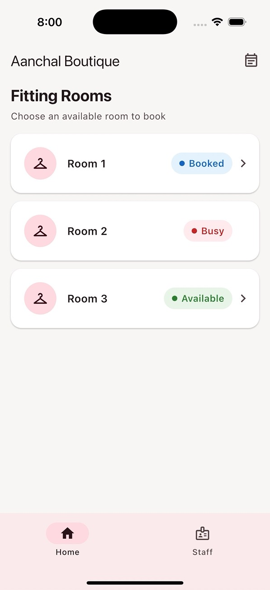

# Aanchal Boutique — Fitting Room Booking App

A Flutter app for booking the boutique's fitting rooms. Customers pick a room,
a day and a 30-minute slot. Staff see each day's schedule and can cancel
bookings. Customers get a reminder notification 1 hour before their fitting.
Everything is stored on the device, so the app works without internet.

| Home | Booking | Bookings | Staff schedule | Reminder | After a cancel |
|---|---|---|---|---|---|
|  |  |  |  |  |  |

## Contents

- [Downloads](#downloads)
- [Demo video](#demo-video)
- [Features](#features)
- [Setup](#setup)
- [Release builds](#release-builds)
- [Architecture](#architecture)
- [Architecture decisions](#architecture-decisions)
- [Data model](#data-model)
- [API documentation](#api-documentation)
- [Postman collection](#postman-collection)
- [Common changes](#common-changes)
- [Testing](#testing)
- [Known limitations](#known-limitations)
- [Troubleshooting](#troubleshooting)

## Downloads

Version 1.0.0 (build 1). Files are in [`delivery/`](delivery/).

| File | What it is |
|---|---|
| [`aanchal-boutique-1.0.0.apk`](delivery/aanchal-boutique-1.0.0.apk) | Android app. Install it directly on a phone (allow "install unknown apps"). |
| [`aanchal-boutique-1.0.0.aab`](delivery/aanchal-boutique-1.0.0.aab) | Android App Bundle. Upload this to the Google Play Console. |
| [`aanchal-boutique-demo.mp4`](delivery/aanchal-boutique-demo.mp4) | 54-second demo video. |

There is no iOS file. An installable iOS app has to be signed with an Apple
Developer account, which this project doesn't have yet. See
[iOS](#ios) for the steps.

## Demo video

[`delivery/aanchal-boutique-demo.mp4`](delivery/aanchal-boutique-demo.mp4)
(54 seconds, iPhone 16 Pro simulator) shows:

1. Home: Room 2 is busy and can't be booked.
2. Booking Room 1: name, date (tomorrow), 10:30 AM slot. The 11:00 AM slot is
   already taken and crossed out. Confirm, success message, Room 1 is Booked.
3. The Bookings list.
4. The Staff tab: tomorrow's schedule, sorted by time.
5. The reminder notification: "Your fitting is in 1 hour — Fitting Room 1 at
   10:30 AM".
6. Staff cancels Zara Ahmed's booking. Room 3 goes back to Available.

The video was recorded by [`integration_test/demo_test.dart`](integration_test/demo_test.dart),
which taps through the real app. Two things in it are set up for the camera:

- Hira Malik's and Zara Ahmed's bookings are demo data.
- In normal use the reminder comes 1 hour before the booking. To show it in
  the video, the script schedules that same reminder (same id and text) to
  fire a few seconds later.

Re-record it with the commands in [Testing](#testing).

## Features

**Home**
- Lists Room 1, 2 and 3 with a status badge: Available (green), Busy (red) or
  Booked (blue).
- Tapping an Available or Booked room opens the booking screen. A Busy room
  shows a message instead.
- The calendar icon opens the Bookings list.

**Booking**
- Customer name (required).
- Date: today and the next 6 days.
- Time: 30-minute slots from 10:00 AM to 5:30 PM (the last slot ends at
  6:00 PM).
- Slots already booked are crossed out. Slots in the past are greyed out.
- Opens on the first day that still has a free slot.
- On confirm: the booking is saved, a success message shows, the room becomes
  Booked, and a reminder is scheduled.

**Bookings list** (calendar icon on Home)
- Upcoming bookings with a Cancel button, and past bookings below.

**Staff tab**
- Every booking for one day, sorted by time, with customer name, room and
  time.
- Switch days with the arrows or the date picker (up to a year back or ahead).
- Cancel (button, or tap the booking) asks for confirmation, deletes the
  booking, frees the room if it has no other upcoming bookings, and cancels
  the reminder.

**Reminders**
- A local notification 1 hour before each booking, e.g. "Fitting Room 2 at
  3:00 PM", including on the lock screen.
- Permission is asked when the first booking is made, not when the app opens.
- Tapping the reminder opens the Bookings list.

## Setup

### Requirements

| Tool | Version used |
|---|---|
| Flutter | 3.35.3 (stable), Dart 3.9.2 |
| Xcode (iOS) | 16.4, iOS 13.0 or later |
| Android SDK (Android) | compile/target SDK 36, minimum SDK 24 (Android 7.0) |

### Run the app

```bash
git clone https://github.com/U-M-A-I-R-Shakeel/Aanchal_Boutique.git
cd Aanchal_Boutique
flutter pub get
flutter run            # picks a connected phone, emulator or simulator
```

### Run the checks

```bash
flutter analyze        # code checks, expected: "No issues found!"
flutter test           # 39 unit and widget tests
```

### App identifiers

| | |
|---|---|
| Android application ID | `com.aanchalboutique.aanchal_boutique` |
| iOS bundle ID | `com.aanchalboutique.aanchalBoutique` |
| Display name | Aanchal Boutique |

## Release builds

### Android

```bash
flutter build apk --release        # build/app/outputs/flutter-apk/app-release.apk
flutter build appbundle --release  # build/app/outputs/bundle/release/app-release.aab
```

**Signing.** Release builds are signed with the key in
`android/app/upload-keystore.jks`, using the passwords in
`android/key.properties`:

```properties
storePassword=...
keyPassword=...
keyAlias=upload
storeFile=upload-keystore.jks
```

Both files are deliberately **not in git** (see `android/.gitignore`), so they
exist only on the computer that made the 1.0.0 build.

> **Back up `android/app/upload-keystore.jks` and `android/key.properties`
> somewhere safe** (for example a password manager). Google Play only accepts
> updates signed with the same key. If the key is lost, the app can't be
> updated under the same listing.

On a computer without these files, release builds still work, but they're
signed with the debug key. That's fine for testing, not for Google Play. To
make a new key instead:

```bash
keytool -genkeypair -v -keystore android/app/upload-keystore.jks \
  -keyalg RSA -keysize 2048 -validity 10000 -alias upload
```

Then create `android/key.properties` as above.

### iOS

iOS builds must be signed with an Apple Developer account
(https://developer.apple.com, paid yearly).

1. Open `ios/Runner.xcworkspace` in Xcode.
2. Select **Runner → Signing & Capabilities**, choose your **Team**, and keep
   or change the bundle ID `com.aanchalboutique.aanchalBoutique`.
3. Build the archive:
   ```bash
   flutter build ipa --release     # build/ios/ipa/*.ipa
   ```
4. Upload it with the **Transporter** app or Xcode's Organizer, then
   distribute through TestFlight or the App Store.

To only check that the release code compiles, without an account:
`flutter build ios --release --no-codesign`. See
[Troubleshooting](#troubleshooting) if this hangs.

## Architecture

Feature-first folders. Each feature has `domain` (models and rules), `data`
(SQLite code) and `presentation` (Riverpod providers and screens).

```
lib/
├── main.dart                     Opens the database, sets up notifications,
│                                 resyncs reminders, starts the app
├── app.dart                      MaterialApp, theme, MainShell as home
├── core/
│   ├── constants/app_strings.dart  All user-facing text
│   ├── database/                 AppDatabase (schema + seed), databaseProvider,
│   │                             DbCodec (date/time <-> text)
│   ├── navigation/               appNavigatorKey (for notification taps)
│   ├── notifications/            NotificationService interface and its
│   │                             flutter_local_notifications implementation
│   ├── theme/                    Colours and ThemeData
│   └── utils/                    clockProvider, date/time formatters (intl)
└── features/
    ├── shell/                    Bottom navigation: Home | Staff
    ├── home/
    │   ├── domain/               Room, RoomStatus, RoomRepository (interface)
    │   ├── data/                 SqliteRoomRepository, syncRoomStatuses()
    │   └── presentation/         roomsProvider, HomeScreen, RoomCard, StatusBadge
    ├── booking/
    │   ├── domain/               Booking, BookingRules, BookingReminders,
    │   │                         BookingRepository (interface), BookingException
    │   ├── data/                 SqliteBookingRepository
    │   └── presentation/         bookingsProvider, bookingsForDateProvider,
    │                             BookingScreen, BookingsScreen, widgets
    └── staff/
        └── presentation/         StaffScreen (daily schedule)
```

### How a booking flows through the app

```
BookingScreen ──Confirm──▶ BookingsNotifier.book()
                             │ 1. checks: name, room not busy, valid slot,
                             │    not in the past, not already taken
                             │ 2. SqliteBookingRepository.create()
                             │      one transaction: insert booking +
                             │      set room status (unique index blocks doubles)
                             │ 3. updates its list, refreshes roomsProvider and
                             │    bookingsForDateProvider
                             │ 4. BookingReminders.schedule() → notification
                             ▼
HomeScreen / StaffScreen rebuild automatically (they watch those providers)
```

Cancelling (Staff tab or Bookings list) goes through `BookingsNotifier.cancel()`
the same way: delete in a transaction, refresh, cancel the reminder.

## Architecture decisions

| Decision | Why |
|---|---|
| **Feature-first folders** | Everything for one feature (home, booking, staff) sits together, so a change rarely spreads across the project. |
| **Riverpod** (`AsyncNotifier`, `Provider`) | Screens rebuild automatically when data changes. Loading and error states come built in. Providers can be swapped in tests without changing app code. |
| **SQLite (`sqflite`) instead of Hive** | Real transactions keep a booking and its room status in step. A unique index lets the database itself refuse a double booking. Date queries for the Staff tab are simple SQL. |
| **Repository interfaces** | Screens and providers never contain SQL. Widget tests use fast in-memory fakes, and a future server could replace SQLite behind the same interface. |
| **The database is the source of truth** | Each write goes to the database first. The in-memory state only changes after the write succeeds, so the screen never shows something that wasn't saved. |
| **Room status stored, and re-checked** | `booked` means "has a confirmed booking that hasn't ended". It's recomputed on every start, booking and cancel, so a room goes back to Available by itself once its bookings are over. Busy is set by staff data and never changed automatically. |
| **Cancelling deletes the booking** | Required by the Staff-view spec. A confirmation dialog guards against mistakes. |
| **Reminders are best-effort** | A booking is saved first. If notifications fail or permission is refused, the booking still stands. |
| **Booking id = notification id** | Cancelling a booking can cancel exactly its reminder. |
| **Reminders rebuilt on start** | After a reinstall or restore, reminders match what's in the database. At most 60 are kept (iOS allows 64 per app). |
| **`clockProvider` for "now"** | Tests can fix the time, so slot and reminder rules are tested exactly. |
| **`IndexedStack` for the tabs** | Switching tabs keeps each tab's state, such as the day picked in Staff. |

## Data model

The database file is `aanchal_boutique.db` in the app's private storage
(`Documents` on iOS, `databases` on Android). Schema version 1, created in
[`lib/core/database/app_database.dart`](lib/core/database/app_database.dart).

**`rooms`**

| Column | Type | Notes |
|---|---|---|
| `id` | TEXT, primary key | `room-1`, `room-2`, `room-3` |
| `name` | TEXT | `Room 1` ... |
| `status` | TEXT | `available`, `busy` or `booked` |
| `sort_order` | INTEGER | Display order on Home |

Seeded on first launch: Room 1 available, Room 2 busy, Room 3 available.

**`bookings`**

| Column | Type | Notes |
|---|---|---|
| `id` | INTEGER, primary key | Also used as the reminder's notification id |
| `room_id` | TEXT | References `rooms.id` |
| `date` | TEXT | `yyyy-MM-dd`, local time |
| `start_time` | TEXT | `HH:mm`, local time |
| `customer_name` | TEXT | |
| `status` | TEXT | `confirmed` (`cancelled` exists in the schema but is no longer written) |
| `created_at` | TEXT | ISO 8601 |
| `cancelled_at` | TEXT, nullable | Unused since cancel deletes the row |

Index `bookings_one_active_per_slot`: unique on `(room_id, date, start_time)`
for confirmed bookings.

## API documentation

The app has **no network API**: it doesn't call or expose any HTTP endpoints.
The "API" a maintainer works with is the set of Dart interfaces and providers
below.

### Booking rules — `BookingRules` ([booking_rules.dart](lib/features/booking/domain/booking_rules.dart))

| Member | Value / behaviour |
|---|---|
| `openingHour`, `closingHour` | `10`, `18` (10:00 AM – 6:00 PM) |
| `slotLength` | 30 minutes |
| `bookingWindowDays` | 7 (today + 6 days) |
| `bookableDates(now)` | The 7 dates, each at midnight |
| `slotsFor(date)` | Slot start times, 10:00 to 17:30 |
| `isPast(slot, now)` | `true` if the slot has started |
| `isValidSlot(start, now)` | `true` if `start` is on the grid and inside the window |

### `BookingRepository` ([booking_repository.dart](lib/features/booking/domain/booking_repository.dart))

| Method | Behaviour |
|---|---|
| `Future<List<Booking>> getBookings()` | All bookings, earliest slot first. |
| `Future<List<Booking>> getBookingsForDate(DateTime date)` | Confirmed bookings on one day, sorted by time (Staff tab). |
| `Future<Booking> create({roomId, start, customerName, now})` | Saves a confirmed booking and marks the room booked, in one transaction. Throws `BookingException` if the room is busy or the slot is taken. |
| `Future<void> cancel(Booking booking, {now})` | Deletes the booking and frees the room if it has no other upcoming booking. Throws `BookingException` if it no longer exists. |

Implemented by `SqliteBookingRepository`.

### `RoomRepository` ([room_repository.dart](lib/features/home/domain/room_repository.dart))

| Method | Behaviour |
|---|---|
| `Future<List<Room>> getRooms({now})` | All rooms in display order, after re-checking Booked/Available against `now`. |

Implemented by `SqliteRoomRepository`.

### `BookingsNotifier` (`bookingsProvider`) ([bookings_provider.dart](lib/features/booking/presentation/providers/bookings_provider.dart))

What the screens call. Its state is `AsyncValue<List<Booking>>`.

| Method | Behaviour |
|---|---|
| `Future<Booking> book({roomId, start, customerName})` | Validates (name not empty, room not busy, valid future slot, not taken), saves, refreshes rooms and the day schedule, schedules the reminder. Throws `BookingException` with a message safe to show the user. |
| `Future<void> cancel(Booking booking)` | Deletes, refreshes, cancels the reminder. |
| `bool isSlotTaken(roomId, start)` | Checks the loaded bookings. |

### Other providers

| Provider | Gives |
|---|---|
| `roomsProvider` | `AsyncValue<List<Room>>` for Home. |
| `bookingsForDateProvider(date)` | `AsyncValue<List<Booking>>` for one day (Staff tab). |
| `bookedSlotsProvider(roomId)` | `Set<DateTime>` of taken slot start times for a room (booking grid). |
| `bookingRemindersProvider` | `BookingReminders`. |
| `databaseProvider` | The open `Database`. Set in `main()`. |
| `notificationServiceProvider` | The `NotificationService`. Set in `main()`. |
| `clockProvider` | `DateTime Function()`, `DateTime.now` by default. |

### Notifications — `NotificationService` ([notification_service.dart](lib/core/notifications/notification_service.dart))

| Method | Behaviour |
|---|---|
| `init({onTap})` | Sets up the plugin. `onTap(payload)` runs when a notification is tapped. |
| `launchedFromNotification()` | Whether a notification tap launched the app. |
| `requestPermission()` | Asks the OS once. Returns whether notifications are allowed. |
| `schedule({id, title, body, at, payload})` | Shows a notification at `at`. Same `id` replaces it. |
| `cancel(id)`, `cancelAllPending()` | Removes scheduled notifications. |

`BookingReminders` ([booking_reminders.dart](lib/features/booking/domain/booking_reminders.dart))
builds on it: `leadTime` (1 hour), `title` ("Your fitting is in 1 hour"),
`body(room, start)` ("Fitting Room 2 at 3:00 PM"), `schedule()`, `cancel()`,
and `resync()`.

## Postman collection

**There isn't one, because there are no API endpoints.** The app is
offline-first and everything runs on the phone. If a backend is added later
(for example to share bookings between the staff phone and customers'
phones), add a Postman collection for it then, and a `BookingRepository`
implementation that calls it.

## Common changes

| To change | Edit |
|---|---|
| Opening hours, slot length, days ahead | `BookingRules` in `lib/features/booking/domain/booking_rules.dart` |
| Reminder lead time or text | `BookingReminders` in `lib/features/booking/domain/booking_reminders.dart` |
| Any text on screen | `lib/core/constants/app_strings.dart` |
| Colours | `lib/core/theme/app_colors.dart` |
| Rooms (names, count, which is Busy) | Seed list in `AppDatabase._onCreate`. This only runs on a **fresh install**. For phones that already have the app, raise `AppDatabase.version` and add an `onUpgrade` that inserts or updates the rows. |
| App icon | Replace the images in `android/app/src/main/res/mipmap-*` and `ios/Runner/Assets.xcassets/AppIcon.appiconset` (or use the `flutter_launcher_icons` package). |
| Version number | `version: 1.0.0+1` in `pubspec.yaml` (raise the `+1` for every store upload). |

After a change, run `flutter analyze` and `flutter test`.

## Testing

| Where | What it covers |
|---|---|
| `test/features/booking/booking_rules_test.dart` | Dates, slots, past and invalid slots |
| `test/features/booking/persistence_test.dart` | Real SQLite file: data survives reopening, cancel deletes, double booking refused, day query sorted |
| `test/features/booking/bookings_provider_test.dart` | Booking/cancel validation against real SQLite (in memory) |
| `test/features/booking/booking_flow_test.dart` | Booking screen: tap room, name, slot, confirm, back Home as Booked |
| `test/features/booking/bookings_screen_test.dart` | Bookings list and cancel |
| `test/features/staff/staff_screen_test.dart` | Tabs, day schedule, date switching, cancel |
| `test/features/home/home_screen_test.dart` | Home statuses |
| `test/features/notifications/booking_reminders_test.dart` | Reminder exactly 1 hour before, text, cancel, resync, iOS limit |
| `integration_test/app_flow_test.dart` | On a device: book, check database and scheduled reminder, restart, staff cancel |
| `integration_test/demo_test.dart` | Drives the app for the demo video |

```bash
flutter test                                  # the 39 tests under test/
flutter test integration_test -d <device-id>  # end-to-end on a phone or simulator
```

The integration tests use their own database files (`e2e_test.db`,
`demo.db`), so they never touch the real bookings.

If `flutter test integration_test` hangs on an iOS simulator, you can build
and launch the test as an app instead. It runs by itself, and prints the
result to the simulator's log:

```bash
flutter build ios --simulator --debug -t integration_test/app_flow_test.dart
xcrun simctl install booted build/ios/iphonesimulator/Runner.app
xcrun simctl launch booted com.aanchalboutique.aanchalBoutique
```

To record the demo video, start a recording, then build and launch
`demo_test.dart` the same way:

```bash
xcrun simctl io booted recordVideo demo.mp4   # Ctrl+C to stop
```

## Known limitations

- **No login on the Staff tab.** Anyone holding the phone can open it and
  cancel bookings. Add a PIN or staff login if customers use the app on
  their own phones.
- **Data lives on one phone.** Bookings aren't shared between devices, and
  uninstalling the app deletes them. A backend or a backup is needed to
  share or protect them.
- **Reminders go to the phone that made the booking.** If staff book for a
  walk-in customer, the reminder goes to the staff phone.
- **No reminder for bookings less than 1 hour away.**
- **On Android, reminders may come a few minutes late** if the phone doesn't
  allow exact alarms.
- **Default Flutter app icon**, also shown on notifications.
- **No web version.** `sqflite` doesn't run in a browser.
- **No iOS install file yet.** That needs an Apple Developer account (see
  [iOS](#ios)).

## Troubleshooting

**`flutter build ios --release` hangs with no progress.** If the Flutter SDK
was downloaded through a browser, macOS can block Flutter's iOS compiler
(`gen_snapshot`) the first time it runs, often behind a hidden security
dialog. Check for that dialog, or clear the download mark on the SDK's iOS
release tools and build again:

```bash
xattr -dr com.apple.quarantine "$(dirname "$(which flutter)")/cache/artifacts/engine/ios-release"
```

**`flutter run` stops after "Xcode build done" on the simulator.** The app is
usually already running; only the debugger failed to attach. Build with
`flutter build ios --simulator`, then install and launch with `xcrun simctl`
as shown in [Testing](#testing).

**No reminder appears.** Check Settings → Notifications → Aanchal Boutique is
allowed, and that the booking is more than an hour away.
