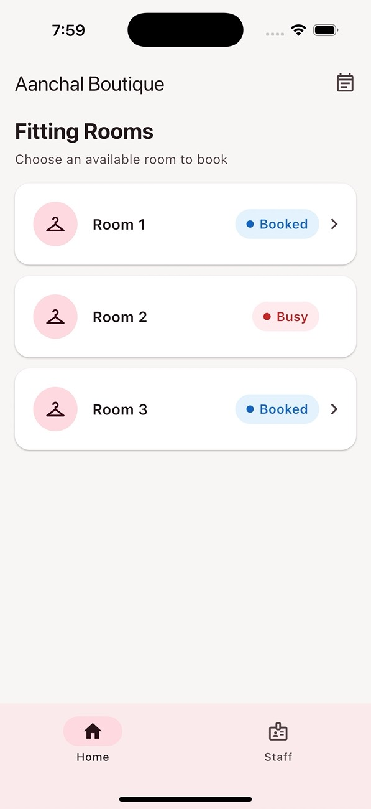
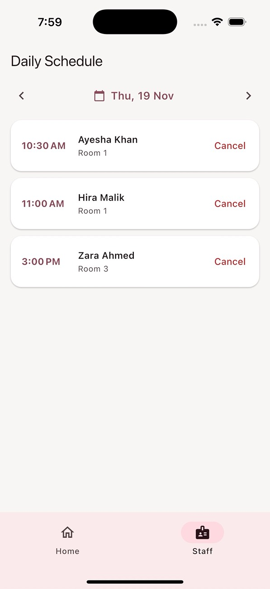

# Aanchal Boutique — Fitting Room Booking App

A mobile app, built in Flutter, that lets Aanchal Boutique's customers book a
fitting room, gives staff a daily schedule to manage bookings, and reminds
customers 1 hour before their fitting. It works fully offline: all data is
stored on the device.

| | |
|---|---|
| **Client** | Aanchal Boutique |
| **Developer** | [U-M-A-I-R-Shakeel](https://github.com/U-M-A-I-R-Shakeel) |
| **Version** | 1.0.0 (build 1) |
| **Platforms** | Android (release delivered), iOS (code ready; needs Apple signing, see [iOS](#ios)) |
| **Repository** | https://github.com/U-M-A-I-R-Shakeel/Aanchal_Boutique |

| Home | Booking | Bookings | Staff schedule | Reminder | After a cancel |
|---|---|---|---|---|---|
|  |  |  |  |  |  |

## Contents

- [Deliverables](#deliverables)
- [Tools and technologies](#tools-and-technologies)
- [Scope of work](#scope-of-work)
- [Features](#features)
- [Demo video](#demo-video)
- [Setup](#setup)
- [Release builds](#release-builds)
- [Architecture](#architecture)
- [Architecture decisions](#architecture-decisions)
- [Data model](#data-model)
- [API documentation](#api-documentation)
- [Postman collection](#postman-collection)
- [Testing](#testing)
- [Maintenance guide](#maintenance-guide)
- [Known limitations and next steps](#known-limitations-and-next-steps)
- [Troubleshooting](#troubleshooting)
- [Handover notes](#handover-notes)

## Deliverables

| Deliverable | Location |
|---|---|
| Android app, installable on a phone | [`delivery/aanchal-boutique-1.0.0.apk`](delivery/aanchal-boutique-1.0.0.apk) |
| Android App Bundle, for Google Play | [`delivery/aanchal-boutique-1.0.0.aab`](delivery/aanchal-boutique-1.0.0.aab) |
| Demo video (56 seconds) | [`delivery/aanchal-boutique-demo.mp4`](delivery/aanchal-boutique-demo.mp4) |
| Source code | This repository (`lib/`, `android/`, `ios/`) |
| Automated tests | `test/` (39 tests) and `integration_test/` (on-device) |
| Documentation | This README |
| Postman collection | Not applicable: the app has no API endpoints (see [Postman collection](#postman-collection)) |

To install the APK on Android: copy it to the phone, open it, and allow
"Install unknown apps" when asked.

## Tools and technologies

| Tool | Version | Used for |
|---|---|---|
| Flutter / Dart | 3.35.3 / 3.9.2 | The app (one codebase for Android and iOS) |
| `flutter_riverpod` | 3.3 | State management |
| `sqflite` | 2.4 | Local SQLite database |
| `flutter_local_notifications` + `timezone` | 20.1 / 0.10 | Booking reminders |
| `intl` | 0.20 | Date and time formatting |
| `flutter_test`, `integration_test`, `sqflite_common_ffi` | — | Unit, widget, database and on-device tests |
| Git + GitHub | — | Version control and delivery |
| Xcode 16.4, Android SDK 36 | — | iOS and Android builds |

## Scope of work

| # | Task | Delivered | Main files |
|---|---|---|---|
| 1 | Project setup and Home screen | Feature-first Flutter project, Riverpod, room list with Available/Busy/Booked badges | `lib/features/home/` |
| 2 | Booking flow with date and time | 7-day date picker, 30-minute slots 10:00 AM–6:00 PM, already-booked slots blocked, success message, room becomes Booked | `lib/features/booking/presentation/screens/booking_screen.dart`, `booking_rules.dart` |
| 3 | Local storage | SQLite database for rooms and bookings, data survives restarts, Bookings list | `lib/core/database/`, `lib/features/*/data/` |
| 4 | Staff view | Bottom navigation (Home / Staff), daily schedule sorted by time, date picker, cancel updates database and room status | `lib/features/shell/`, `lib/features/staff/` |
| 5 | Booking reminders | Local notification 1 hour before each booking, e.g. "Fitting Room 2 at 3:00 PM"; tapping it opens the app | `lib/core/notifications/`, `booking_reminders.dart` |
| 6 | Delivery package | Signed Android release, README, demo video, uploaded to this repository | `delivery/`, `README.md` |

## Features

**Home**
- Lists Room 1, 2 and 3 with a status badge: Available (green), Busy (red) or
  Booked (blue).
- Tapping an Available or Booked room opens the booking screen. A Busy room
  shows a message instead.
- The calendar icon opens the Bookings list.

**Booking**
- Customer name (required), a date (today and the next 6 days) and a
  30-minute slot from 10:00 AM to 5:30 PM (the last slot ends at 6:00 PM).
- Taken slots are crossed out and past slots greyed out, so a slot can't be
  booked twice.
- Opens on the first day that still has a free slot.
- Confirming saves the booking, shows a success message, marks the room
  Booked and schedules the reminder.

**Bookings list** (calendar icon on Home)
- Upcoming bookings with a Cancel button, and past bookings below.

**Staff tab**
- Every booking for a chosen day, sorted by time, with customer name, room
  and time.
- Change day with the arrows or the date picker.
- Cancel asks for confirmation, deletes the booking, frees the room if it has
  no other upcoming bookings, and cancels the reminder.

**Reminders**
- A notification 1 hour before each booking, also shown on the lock screen.
- Permission is requested on the first booking, not when the app opens.
- Tapping the reminder opens the Bookings list.

## Demo video

[`delivery/aanchal-boutique-demo.mp4`](delivery/aanchal-boutique-demo.mp4)
(56 seconds, iPhone 16 Pro simulator) shows:

1. Home: Room 2 is busy and can't be booked.
2. Booking Room 1 for Umair: tomorrow, 10:30 AM. Sufyan's 11:00 AM booking
   is crossed out. Confirm, success message, Room 1 is Booked.
3. The Bookings list.
4. The Staff tab: tomorrow's schedule (Umair, Sufyan, Abdul Rehman), sorted
   by time.
5. The reminder: "Your fitting is in 1 hour — Fitting Room 1 at 10:30 AM".
6. Staff cancels Abdul Rehman's booking. Room 3 goes back to Available.

The video was recorded by [`integration_test/demo_test.dart`](integration_test/demo_test.dart),
which taps through the real app. Two things are set up for the camera:

- Sufyan's and Abdul Rehman's bookings are sample data added by the script.
- A reminder normally arrives 1 hour before the booking. To show it in the
  video, the script schedules the same reminder (same id and text) to arrive
  a few seconds later.

## Setup

### Requirements

| Tool | Version |
|---|---|
| Flutter | 3.35.3 stable (Dart 3.9.2) |
| Xcode (for iOS) | 16.4 or later; iOS 13.0+ devices |
| Android SDK (for Android) | compile/target SDK 36; Android 7.0 (SDK 24)+ devices |

### Run the app

```bash
git clone https://github.com/U-M-A-I-R-Shakeel/Aanchal_Boutique.git
cd Aanchal_Boutique
flutter pub get
flutter run            # on a connected phone, emulator or simulator
```

### Check the code

```bash
flutter analyze        # expected: "No issues found!"
flutter test           # expected: 39 tests, "All tests passed!"
```

### App identifiers

| | |
|---|---|
| Display name | Aanchal Boutique |
| Android application ID | `com.aanchalboutique.aanchal_boutique` |
| iOS bundle ID | `com.aanchalboutique.aanchalBoutique` |

## Release builds

### Android

```bash
flutter build apk --release        # build/app/outputs/flutter-apk/app-release.apk
flutter build appbundle --release  # build/app/outputs/bundle/release/app-release.aab
```

Release builds are signed with the upload key in
`android/app/upload-keystore.jks`; its passwords are in
`android/key.properties`:

```properties
storePassword=...
keyPassword=...
keyAlias=upload
storeFile=upload-keystore.jks
```

Both files are **included in this repository**, at the client's request, so
release builds can be made straight from a clone.

> **Warning:** this repository is public, so this key is visible to anyone.
> Before publishing on Google Play, create a new key that is kept private
> (command below), put it in place of these two files, and keep it out of any
> public repository. Google Play only accepts updates signed with the key used
> for the first upload.

If the two files are removed, release builds fall back to the debug key: fine
for testing, not accepted by Google Play. To create a new key:

```bash
keytool -genkeypair -v -keystore android/app/upload-keystore.jks \
  -keyalg RSA -keysize 2048 -validity 10000 -alias upload
```

### iOS

An iOS app can only be installed or published once it is signed with an
Apple Developer account (https://developer.apple.com, yearly fee). Version
1.0.0 doesn't include an iOS file for that reason. With an account:

1. Open `ios/Runner.xcworkspace` in Xcode.
2. **Runner → Signing & Capabilities**: choose the **Team**; keep or change
   the bundle ID `com.aanchalboutique.aanchalBoutique`.
3. Build: `flutter build ipa --release` (output in `build/ios/ipa/`).
4. Upload with Apple's **Transporter** app or Xcode Organizer, then release
   through TestFlight or the App Store.

## Architecture

Feature-first structure: each feature keeps its own `domain` (models and
rules), `data` (SQLite) and `presentation` (Riverpod providers and screens).

```
lib/
├── main.dart                     Opens the database, sets up notifications,
│                                 rebuilds reminders, starts the app
├── app.dart                      MaterialApp, theme, bottom-navigation shell
├── core/
│   ├── constants/app_strings.dart  All on-screen text
│   ├── database/                 AppDatabase (schema + starting rooms),
│   │                             databaseProvider, DbCodec
│   ├── navigation/               appNavigatorKey (for notification taps)
│   ├── notifications/            NotificationService + implementation
│   ├── theme/                    Colours and theme
│   └── utils/                    clockProvider, date/time formatting
└── features/
    ├── shell/                    Bottom navigation: Home | Staff
    ├── home/                     Rooms: model, SQLite repository, Home screen
    ├── booking/                  Bookings: model, rules, reminders, SQLite
    │                             repository, Booking + Bookings screens
    └── staff/                    Daily schedule screen
```

### How a booking flows

```
BookingScreen ──Confirm──▶ BookingsNotifier.book()
                             1. checks: name, room not busy, valid future
                                slot, not already taken
                             2. SqliteBookingRepository.create(): one
                                transaction saves the booking and the room
                                status (a unique index blocks double booking)
                             3. refreshes rooms and the day's schedule
                             4. BookingReminders.schedule(): the reminder
                             ▼
Home and Staff screens update automatically (they watch these providers)
```

Cancelling (Staff tab or Bookings list) runs through
`BookingsNotifier.cancel()`: delete in a transaction, refresh, cancel the
reminder.

## Architecture decisions

| Decision | Reason |
|---|---|
| **Feature-first folders** | Each feature's code sits together, so changes stay local. |
| **Riverpod** | Screens rebuild automatically when data changes; loading and error states are built in; tests can swap any provider. |
| **SQLite instead of Hive** | Transactions keep a booking and its room status in step; a unique index lets the database itself refuse double bookings; date queries are simple SQL. |
| **Repository interfaces** | Screens never contain SQL. Tests use fast in-memory fakes, and a server could later replace SQLite behind the same interface. |
| **Database first, then screen** | Every write goes to the database before the in-memory state changes, so the screen never shows something that wasn't saved. |
| **Room status re-checked** | "Booked" means a confirmed booking that hasn't ended. It's recomputed on start, booking and cancel, so rooms free themselves once bookings are over. "Busy" is never changed automatically. |
| **Cancel deletes the booking** | As specified for the Staff view; a confirmation dialog guards against mistakes. |
| **Reminders never block a booking** | The booking is saved first; if notifications fail or are refused, the booking still stands. |
| **Booking id = notification id** | Cancelling a booking cancels exactly its reminder. |
| **Reminders rebuilt on start** | After a reinstall, reminders match the database. Up to 60 are kept (iOS allows 64 per app). |
| **Injected clock** | Tests fix "now", so slot and reminder timing are tested exactly. |

## Data model

SQLite file `aanchal_boutique.db` in the app's private storage, schema
version 1 ([`app_database.dart`](lib/core/database/app_database.dart)).

**`rooms`**

| Column | Type | Notes |
|---|---|---|
| `id` | TEXT, primary key | `room-1`, `room-2`, `room-3` |
| `name` | TEXT | `Room 1` ... |
| `status` | TEXT | `available`, `busy` or `booked` |
| `sort_order` | INTEGER | Order on the Home screen |

Created on first launch with Room 1 available, Room 2 busy, Room 3 available.

**`bookings`**

| Column | Type | Notes |
|---|---|---|
| `id` | INTEGER, primary key | Also the reminder's notification id |
| `room_id` | TEXT | References `rooms.id` |
| `date` | TEXT | `yyyy-MM-dd`, local time |
| `start_time` | TEXT | `HH:mm`, local time |
| `customer_name` | TEXT | |
| `status` | TEXT | `confirmed` |
| `created_at` | TEXT | ISO 8601 |
| `cancelled_at` | TEXT, nullable | Not used (cancel deletes the row) |

Unique index `bookings_one_active_per_slot` on `(room_id, date, start_time)`
for confirmed bookings.

## API documentation

The app has **no network API**: it neither calls nor exposes HTTP endpoints.
These are the Dart interfaces a developer works with.

### `BookingRules` — [booking_rules.dart](lib/features/booking/domain/booking_rules.dart)

| Member | Value / behaviour |
|---|---|
| `openingHour`, `closingHour` | `10`, `18` |
| `slotLength` | 30 minutes |
| `bookingWindowDays` | 7 (today + 6) |
| `bookableDates(now)` | The 7 dates |
| `slotsFor(date)` | Slot start times, 10:00–17:30 |
| `isPast(slot, now)` | Whether the slot has started |
| `isValidSlot(start, now)` | Whether `start` is on the grid and in the window |

### `BookingRepository` — [booking_repository.dart](lib/features/booking/domain/booking_repository.dart)

| Method | Behaviour |
|---|---|
| `getBookings()` | All bookings, earliest first |
| `getBookingsForDate(date)` | Confirmed bookings on one day, sorted by time |
| `create({roomId, start, customerName, now})` | Saves the booking and marks the room booked in one transaction. Throws `BookingException` if the room is busy or the slot is taken. |
| `cancel(booking, {now})` | Deletes it and frees the room if it has no other upcoming booking. Throws `BookingException` if already gone. |

### `RoomRepository` — [room_repository.dart](lib/features/home/domain/room_repository.dart)

| Method | Behaviour |
|---|---|
| `getRooms({now})` | All rooms in order, with Booked/Available re-checked |

### `BookingsNotifier` (`bookingsProvider`) — [bookings_provider.dart](lib/features/booking/presentation/providers/bookings_provider.dart)

| Method | Behaviour |
|---|---|
| `book({roomId, start, customerName})` | Validates, saves, refreshes rooms and schedule, schedules the reminder. Throws `BookingException` with a user-friendly message. |
| `cancel(booking)` | Deletes, refreshes, cancels the reminder |
| `isSlotTaken(roomId, start)` | Checks the loaded bookings |

### Providers

| Provider | Provides |
|---|---|
| `roomsProvider` | Rooms for Home |
| `bookingsForDateProvider(date)` | One day's bookings for the Staff tab |
| `bookedSlotsProvider(roomId)` | Taken slot times for a room |
| `bookingRemindersProvider` | `BookingReminders` |
| `databaseProvider`, `notificationServiceProvider` | Set in `main()` |
| `clockProvider` | Current time (`DateTime.now`) |

### `NotificationService` — [notification_service.dart](lib/core/notifications/notification_service.dart)

| Method | Behaviour |
|---|---|
| `init({onTap})` | Sets up notifications; `onTap` runs when one is tapped |
| `launchedFromNotification()` | Whether a notification opened the app |
| `requestPermission()` | Asks once; returns whether allowed |
| `schedule({id, title, body, at, payload})` | Notification at `at`; same `id` replaces it |
| `cancel(id)`, `cancelAllPending()` | Removes scheduled notifications |

`BookingReminders` ([booking_reminders.dart](lib/features/booking/domain/booking_reminders.dart))
builds on it: `leadTime` (1 hour), `title` ("Your fitting is in 1 hour"),
`body(room, start)` ("Fitting Room 2 at 3:00 PM"), `schedule`, `cancel`,
`resync`.

## Postman collection

**Not included, because there are no API endpoints.** The app is
offline-first and everything runs on the phone. If a backend is added later
(for example to share bookings between the staff phone and customers'
phones), a Postman collection should be created for it, together with a
`BookingRepository` implementation that calls it.

## Testing

| Test file | Covers |
|---|---|
| `test/features/booking/booking_rules_test.dart` | Dates, slots, past and invalid slots |
| `test/features/booking/persistence_test.dart` | Real SQLite file: data survives reopening, cancel deletes, no double booking |
| `test/features/booking/bookings_provider_test.dart` | Booking and cancel rules against real SQLite |
| `test/features/booking/booking_flow_test.dart` | Booking screen end to end |
| `test/features/booking/bookings_screen_test.dart` | Bookings list and cancel |
| `test/features/staff/staff_screen_test.dart` | Tabs, schedule, switching days, cancel |
| `test/features/home/home_screen_test.dart` | Room statuses |
| `test/features/notifications/booking_reminders_test.dart` | Reminder exactly 1 hour before, text, cancel, rebuild |
| `integration_test/app_flow_test.dart` | On a real device or simulator: book, database row, scheduled reminder, restart, staff cancel |
| `integration_test/demo_test.dart` | Drives the app for the demo video |

```bash
flutter test                                  # 39 tests
flutter test integration_test -d <device-id>  # on a phone or simulator
```

Both integration tests use their own database files, so real bookings are
never touched. Results for version 1.0.0: all 39 tests pass, and
`app_flow_test.dart` passes on the iPhone 16 Pro simulator.

## Maintenance guide

| To change | Edit |
|---|---|
| Opening hours, slot length, days ahead | `lib/features/booking/domain/booking_rules.dart` |
| Reminder time or text | `lib/features/booking/domain/booking_reminders.dart` |
| On-screen text | `lib/core/constants/app_strings.dart` |
| Colours | `lib/core/theme/app_colors.dart` |
| Rooms | Starting list in `AppDatabase._onCreate`. It only runs on a fresh install, so for existing phones raise `AppDatabase.version` and add an `onUpgrade` step. |
| App icon | `android/app/src/main/res/mipmap-*` and `ios/Runner/Assets.xcassets/AppIcon.appiconset` |
| Version | `version: 1.0.0+1` in `pubspec.yaml` (raise `+1` for every store upload) |

After any change: `flutter analyze` and `flutter test`.

## Known limitations and next steps

| Limitation | Suggested next step |
|---|---|
| No login on the Staff tab: anyone holding the phone can cancel bookings | Add a staff PIN or login |
| Data lives on one phone; uninstalling deletes it | Add a backend or cloud backup to share and protect bookings |
| Reminders go to the phone that made the booking | Collect customer phone numbers and send SMS/WhatsApp reminders from a backend |
| No reminder for bookings less than 1 hour away | Send a confirmation notification instead |
| Android may deliver reminders a few minutes late if exact alarms aren't allowed | Ask for the exact-alarm permission in settings |
| Default Flutter app icon (also on notifications) | Add the boutique's logo |
| No web version (`sqflite` doesn't run in browsers) | Only needed if a web version is wanted |
| No iOS file in 1.0.0 | Sign with an Apple Developer account (see [iOS](#ios)) |

## Troubleshooting

**`flutter build ios --release` hangs.** If Flutter was downloaded through a
web browser, macOS may block Flutter's iOS compiler on first use, sometimes
behind a hidden security dialog. Allow it, or clear the download mark and
build again:

```bash
xattr -dr com.apple.quarantine "$(dirname "$(which flutter)")/cache/artifacts/engine/ios-release"
```

**`flutter run` stops after "Xcode build done" on a simulator.** The app is
usually running already; only the debugger didn't attach. Build with
`flutter build ios --simulator`, then
`xcrun simctl install booted build/ios/iphonesimulator/Runner.app` and
`xcrun simctl launch booted com.aanchalboutique.aanchalBoutique`.

**No reminder appears.** Check that notifications are allowed for Aanchal
Boutique in the phone's settings, and that the booking is more than an hour
away.

## Handover notes

- **Android signing key.** `android/app/upload-keystore.jks` and
  `android/key.properties` are included in this repository. Because the
  repository is public, replace them with a new private key before the first
  Google Play upload (see [Android](#android)), and store that key safely
  (for example in a password manager).
- **Google Play.** Upload `delivery/aanchal-boutique-1.0.0.aab` in the Play
  Console. A store listing, screenshots and a privacy policy are needed there.
- **iOS.** Needs an Apple Developer account before an iOS file can be built
  (see [iOS](#ios)).
